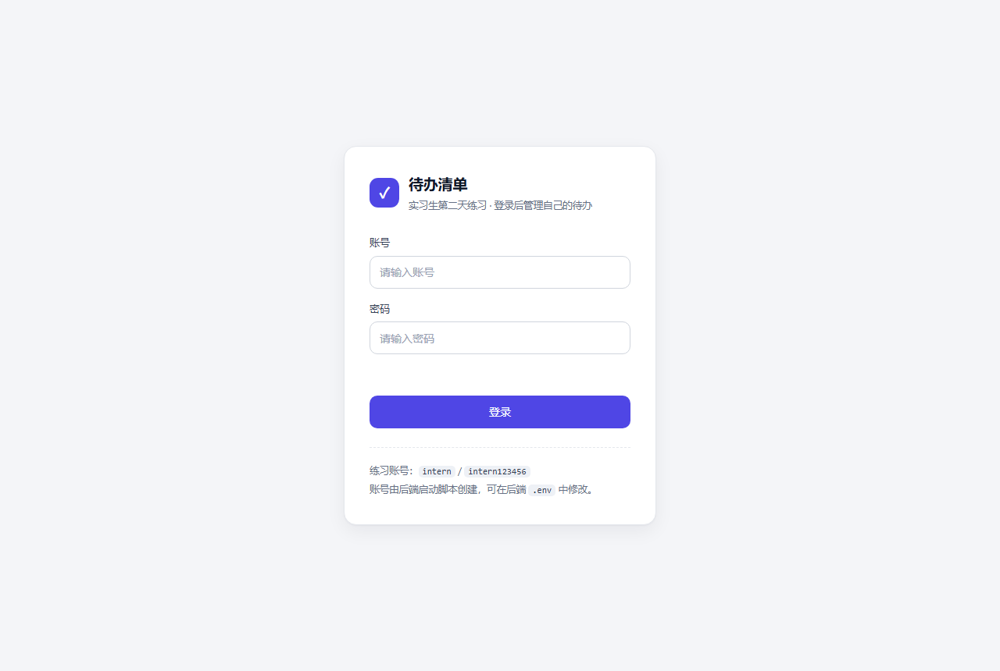
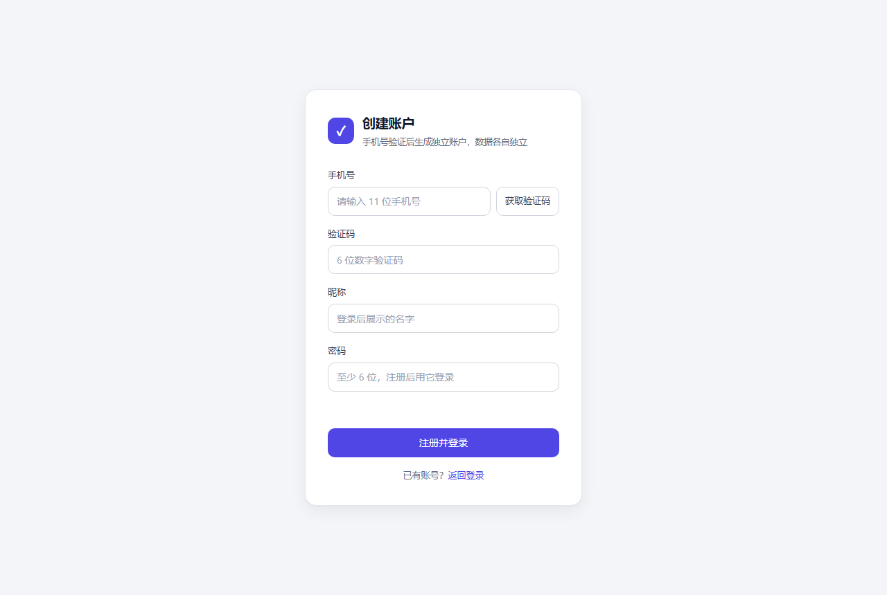
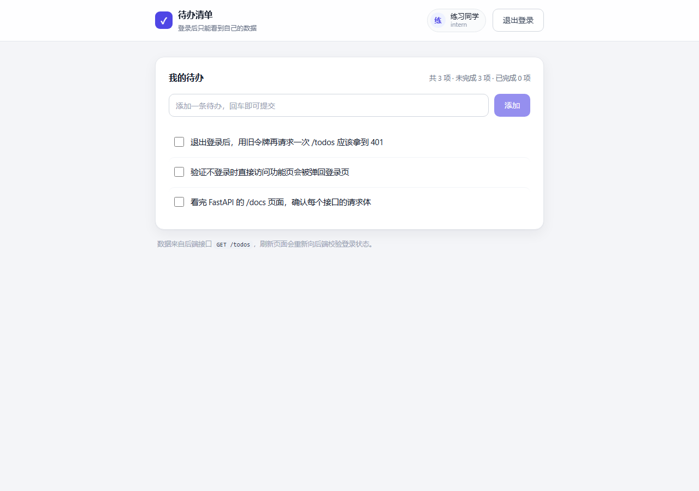
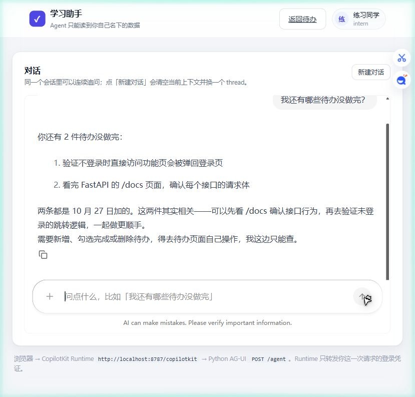

# intern-day-2-frontend

实习生第二天练习的前端仓库：**React + TypeScript + Vite**，完成「手机号注册 / 登录 → 查看当前用户 → 管理待办 → 退出」的完整链路，每个账户只看得到自己的数据。

- 后端仓库（配套）：`https://github.com/givenkills/intern-day-2-backend`
- 当前联调分支：`feat/login-and-todo`（两个仓库同分支名）
- 配套 PR：https://github.com/givenkills/intern-day-2-backend/pull/1
- 页面地址：<http://localhost:5173>







---

## 第三天新增：CopilotKit 对话入口

在登录后的页面加了「问助手」入口（路由 `/assistant`，同样受 `ProtectedRoute` 保护）。它通过 CopilotKit 接入后端的 Microsoft Agent Framework Agent，链路走 AG-UI。

| 项 | 值 |
| --- | --- |
| 功能分支 | `feat/agent-chat`（两个仓库同名） |
| 新增服务 | `server/copilot-runtime.mjs`（Express + `@copilotkit/runtime` v2） |
| 新增页面 | `src/pages/AssistantPage.tsx` |
| 鉴权 | `Authorization` 由 Provider 的 `headers` 每次请求现取，Runtime 原样透传 |
| 原理说明 | 在后端仓库（`feat/agent-chat` 分支）：<https://github.com/givenkills/intern-day-2-backend/blob/feat/agent-chat/docs/day-3-agent-learning.md> |
| 交互图 | 在后端仓库（`feat/agent-chat` 分支）：<https://github.com/givenkills/intern-day-2-backend/blob/feat/agent-chat/docs/diagrams/day-3-agent-interaction.png> |

和任务说明的约定一致：**两个仓库不各写一份原理说明**，前端只链接后端分支里的那一份。

### 拓扑：为什么多了一个 8787

```
浏览器 :5173  ──POST /copilotkit/agent/todo_assistant/run──▶  Runtime :8787
                                                                  │
                                              POST /agent (AG-UI) │ Authorization 原样带过去
                                                                  ▼
                                                        backend :8000  (容器内服务名)
```

浏览器只能访问宿主机端口，**访问不到容器服务名**，所以地址分工是：

> 注意：从 CopilotKit 1.82 起，`runtimeUrl` 就是**接口前缀本身**，客户端会在它后面直接拼 `/info`、`/agent/<id>/run`。只写 `http://localhost:8787` 会让请求打到根路径并 404，页面表现为输入框没反应、检查器显示 Runtime Offline。

| 谁访问 | 地址 | 配在哪 |
| --- | --- | --- |
| 浏览器 → 前端 | `http://localhost:5173` | 宿主机浏览器 |
| 浏览器 → Runtime | `http://localhost:8787/copilotkit` | `VITE_COPILOT_RUNTIME_URL`（末尾 `/copilotkit` 不能省） |
| 浏览器 → 后端（原有功能） | `http://localhost:8000` | `VITE_API_BASE_URL` |
| Runtime 容器 → 后端 | `http://backend:8000/agent` | compose 里的 `AGENT_URL` |

### Runtime 到底是什么

一个 60 行的 Express 服务，三件事：

1. **协议搬运**：把 CopilotKit 的请求翻译成 AG-UI 的 `RunAgentInput`；
2. **按请求解析 Agent**：`agents` 写成函数，每次请求新建 `HttpAgent` 并塞进这个用户自己的 `Authorization`——写成固定对象就会变成所有人共用一个身份；
3. **原样转发事件流**：不缓冲，收到一条转一条。

**Vite 不能顶替它**：Vite 是静态资源服务器 + HMR，没有 `/copilotkit` 下的运行时路由，也不会做协议翻译。给它配 `server.proxy` 只能解决转发，解决不了翻译。

### 本地怎么起（三个进程）

```bash
docker network create intern-agent-net     # 只需一次

# 后端仓库
cd ../intern-day-2-backend && uv run uvicorn app.main:app --port 8000

# 本仓库：终端 1（Runtime）
AGENT_URL=http://127.0.0.1:8000/agent pnpm runtime

# 本仓库：终端 2（页面）
pnpm dev
```

本机直跑时 `AGENT_URL` 用 `127.0.0.1`；容器里必须用 `http://backend:8000/agent`。

### 容器

```bash
docker network create intern-agent-net
docker compose up --build
```

一个镜像跑两个服务：`frontend`（Vite，5173）和 `runtime`（Node，从 8787 起），后者只改启动命令。

### 对话行为

| 操作 | 表现 |
| --- | --- |
| 发送中 | 输入框禁用，回复逐字增长 |
| 空输入 | 发送按钮禁用（组件自带） |
| 失败 | 气泡内提示错误，**退出加载态**，可重试 |
| 401 | 页面顶部出现「登录状态已失效」，点按钮重新登录 |
| 新建对话 | 换 `threadId` 并让 Provider 以新 key 重挂载，消息列表清空 |
| 退出登录 | 令牌清除；`threadId` 按 user id 分开存，换账号不会串 |

历史全部由浏览器持有，**刷新会清空当前会话**；后端不落库，所以也没有「服务端重启后历史消失」的问题——本来就没有。

---



---

## 1. 功能范围

| 页面 | 内容 |
| --- | --- |
| `/login` | 账号或手机号、密码（密码框）、登录按钮；必填校验、提交中禁用、错误提示 |
| `/register` | 手机号、获取验证码（60 秒倒计时）、验证码、昵称、密码；注册成功直接登录 |
| `/todos` | 顶部显示后端返回的当前用户；待办新增、勾选完成、删除；统计与空状态 |

必做流程：打开登录页 → 输入账号密码 → 后端校验 → 进入功能页 → 从 `/auth/me` 读取并显示用户 → 使用待办功能 → 退出登录。
额外支持：任意虚构手机号注册新账户，注册后自动登录，账户之间的待办互不可见。

### 验收条件

1. 未登录访问 `/todos` 会被重定向回 `/login`，不展示任何受保护内容。
2. 账号或密码错误时显示后端返回的统一提示，不区分「账号不存在」和「密码错误」。
3. 登录成功后功能页显示后端返回的 `display_name` 与账号（手机号注册的账户显示手机号）。
4. 待办的增、改、删都通过真实后端接口完成，刷新后数据仍在。
5. 任意接口返回 `401` 时，本地登录状态被清理并提示重新登录。
6. 刷新页面后保持登录，但会重新调用 `/auth/me` 校验；校验失败即回到登录页。
7. 点击退出后回到登录页，本地令牌被清除。
8. 注册页能拿到验证码、注册成功自动进入功能页；验证码错误或手机号已注册时有明确提示。
9. 不同账户登录后只能看到自己的待办，新注册的账户列表为空。

---

## 2. 登录状态是怎么处理的

**令牌保存在 `localStorage`，每次请求放在 `Authorization: Bearer <token>` 头里。**

| 场景 | 行为 |
| --- | --- |
| 登录成功 | 先存令牌，再调 `/auth/me`；两者都成功才算「已登录」 |
| 注册成功 | 与登录同一套逻辑（`AuthContext.adoptSession`）：存令牌 → 调 `/auth/me` → 进入功能页 |
| 刷新页面 | 有令牌就先调 `/auth/me` 校验，期间显示「正在校验登录状态」；通过则保持登录，不通过则清理并回到登录页 |
| 任意接口返回 `401` | `src/api/client.ts` 里的全局回调触发，清空令牌与用户、跳回登录页并提示「登录状态已失效」 |
| 退出登录 | 调用 `POST /auth/logout` 让后端删除会话，无论成功与否都清空本地状态 |

为什么不用 Cookie：前后端在不同端口，用 Cookie 需要额外处理 `credentials`、`SameSite` 和 CSRF，练习项目用 Bearer 令牌更直观，调试时在浏览器网络面板也能直接看到。

> 说明：前端的路由守卫只是体验优化。真正的鉴权在后端——绕过前端直接请求接口同样会被拒绝（见下方自测记录）。
> 账户隔离同样由后端保证：`/todos` 的每条 SQL 都带 `user_id` 条件，前端拿不到别人的数据，也不存在「切换账户串数据」。如果两个浏览器窗口分别登录两个账户，各自只能看到自己的列表。

---

## 3. 与后端的接口约定

后端地址通过 `VITE_API_BASE_URL` 配置，默认 `http://localhost:8000`。

| 方法 | 路径 | 用途 |
| --- | --- | --- |
| POST | `/auth/sms/send` | 提交 `{phone}`，返回 `{expires_in, resend_after, debug_code, masked_phone}`；开发模式下页面直接显示验证码 |
| POST | `/auth/register` | 提交 `{phone, code, password, display_name}`，返回 `201` 与登录令牌 |
| POST | `/auth/login` | 提交 `{username, password}`，`username` 可填账号或手机号，返回 `{access_token, token_type, expires_at}` |
| GET | `/auth/me` | 返回 `{id, username, phone, display_name, created_at}` |
| POST | `/auth/logout` | 返回 `204`，服务端删除会话 |
| GET | `/todos` | 当前用户的待办数组 |
| POST | `/todos` | 提交 `{title}`，返回 `201` |
| PATCH | `/todos/{id}` | 提交 `{done?}` 或 `{title?}` |
| DELETE | `/todos/{id}` | 返回 `204` |

错误处理：`401` 统一走「清理登录状态」，其余状态码（`400` 验证码错误、`409` 手机号已注册、`429` 发送过于频繁、`422` 参数校验）把后端返回的 `detail` 直接展示在页面上。

---

## 4. 在开发容器中开发（推荐）

1. 用 VS Code 打开本仓库目录。
2. 命令面板执行 **Dev Containers: Reopen in Container**。
3. 容器创建后自动执行 `pnpm install`。

容器内可用命令：

```bash
git --version
node --version       # 22
pnpm --version       # 9.15.9

cp .env.example .env   # 按需修改 VITE_API_BASE_URL
pnpm dev               # 默认 5173，已配置 host 0.0.0.0
pnpm typecheck
pnpm build
```

---

## 5. 独立启动（Docker Compose）

```bash
cp .env.example .env      # 可选：不建 .env 也能用默认值启动
docker compose config
docker compose up --build -d
docker compose ps
docker compose logs --tail=100
```

打开 <http://localhost:5173>，先确保后端已经在 <http://localhost:8000> 运行。

停止并重新创建：

```bash
docker compose down
docker compose up --build -d
```

> 本仓库的 `compose.yaml` 只启动前端。它和后端仓库是**两个独立的 Compose 项目**，
> 各自构建、各自启动，构建上下文互不依赖。

---

## 6. 前后端联调

```bash
# 终端 1：后端仓库根目录
docker compose up --build -d

# 终端 2：前端仓库根目录
docker compose up --build -d
```

关键点（这也是最容易踩坑的地方）：

- 浏览器直接访问宿主机端口：前端 `localhost:5173`，后端 `localhost:8000`。
- 前端里的 API 地址必须是 `http://localhost:8000`。写成 `http://backend:8000` 会失败——那是容器内网名字，浏览器解析不了，两个 Compose 项目之间也没有共享网络。
- 后端需要放行前端来源：`CORS_ORIGINS=http://localhost:5173`，并且要允许 `OPTIONS` 预检与 `Authorization` 请求头。

### 想换端口怎么办

前端改 `FRONTEND_PORT`（或 `pnpm dev --port 5273`），后端要同步把 `CORS_ORIGINS` 加上新地址，否则浏览器会在预检阶段被拦下，表现是「登录后立刻被弹回登录页」。

---

## 7. 账号

**练习账号**（由后端启动时创建）：

```
账号：intern
密码：intern123456
```

**也可以自己注册**：登录页底部「用手机号注册」→ 填任意 11 位虚构手机号 → 点「获取验证码」→ 页面会直接显示开发环境的验证码 → 填昵称和密码即可。注册成功后自动登录。

修改练习账号见后端仓库的 `SEED_USERNAME` / `SEED_PASSWORD`。前端不保存任何账号信息。

---

## 8. 自测记录

测试环境：Windows 11 + Docker Desktop（容器内 Node 22），Chrome 视口 1280×800。
完整的逐项记录（操作步骤、预期结果、15 张页面截图、命令输出）见 **[docs/自测报告.md](docs/自测报告.md)**。

### 8.1 任务自测清单（12 项，全部通过）

| # | 检查项 | 预期结果 | 实际结果 | 结论 |
| --- | --- | --- | --- | --- |
| 1 | 容器启动 | 前后端服务同时正常运行 | 前端 `Up` 映射 5173、后端 `Up (healthy)` 映射 8000；首页与 `/health` 均 `200` | 通过 |
| 2 | 正常登录 | 进入功能页，显示后端返回的当前用户 | 跳转 `/todos`，右上角显示「练习同学 / intern」 | 通过 |
| 3 | 无效登录 | 登录失败或被校验拦截；错误账号与错误密码提示统一 | 空值提示「请输入账号和密码」；错误密码与不存在账号均显示「账号或密码不正确」 | 通过 |
| 4 | 页面保护 | 返回登录页，不展示受保护内容 | 未登录访问 `/todos`，`location.pathname` 变为 `/login`，页面无待办内容 | 通过 |
| 5 | 接口保护 | 返回 `401`，无法绕过前端访问数据 | 页面内直接 `fetch` 无凭证 / 伪造凭证的 `/auth/me` 均为 `401`；浏览器打开 `/todos` 显示拒绝信息 | 通过 |
| 6 | 刷新页面 | 与 README 描述一致，需重新向后端校验 | F5 后仍在 `/todos`，`AuthContext` 重新调用 `/auth/me` 通过后才置为已登录 | 通过 |
| 7 | 凭证过期 | 后端返回 `401`，前端提示重新登录 | 有效期改为 1 分钟后等待 70 秒，再操作 → 跳回 `/login`，提示「登录状态已失效，请重新登录」，令牌清空 | 通过 |
| 8 | 退出登录 | 返回登录页；旧凭证访问受保护接口 `401` | 回到 `/login`，令牌为 `null`；旧令牌请求 `/todos` → `401` | 通过 |
| 9 | 自选功能 | 后端处理数据，前端显示真实结果 | 新增 0→1 条，勾选后统计变为「未完成 0 项 · 已完成 1 项」，刷新后仍在 | 通过 |
| 10 | 网络异常 | 显示可理解的失败提示，恢复后可重新操作 | 停后端后提示「无法连接后端服务，请确认后端已启动」；按钮从「登录中…」恢复，重启后登录成功 | 通过 |
| 11 | 重启验证 | 能按 README 初始化或读取账号，数据与会话符合说明 | `down` 后 `up --build -d`，刷新页面仍可登录，待办条数不变 | 通过 |
| 12 | 交付复现 | 可复现初始化、启动、登录和自选功能 | 另一目录克隆两仓库并切到 `feat/login-and-todo`，`compose up` 后页面正常；全新卷自动初始化 3 条示例待办 | 通过 |

> 第 12 项说明：两个仓库的默认分支已设为 `feat/login-and-todo`，克隆下来就是完整代码；`main` 只保留基础骨架，用于 PR 对比。本机复现时为拿到全新数据卷临时用了独立 Compose 项目名，等价于换一台机器。

### 8.2 构建与静态检查

| 检查 | 命令 | 结果 |
| --- | --- | --- |
| 类型检查 | `pnpm typecheck` | 通过，无报错 |
| 生产构建 | `pnpm build` | 通过，产物约 258 kB（gzip 82 kB） |
| 依赖锁定 | `docker build` | 按 `pnpm-lock.yaml` 安装（`--frozen-lockfile`） |
| Compose 配置 | `docker compose config` | 校验通过 |

### 8.3 补充检查（页面层）

| 检查项 | 操作 | 实际结果 |
| --- | --- | --- |
| 注册入口 | 登录页点「用手机号注册」 | 跳到 `/register` |
| 发送验证码 | 填手机号后点「获取验证码」 | 页面显示 6 位演示验证码，按钮进入「59s 后重发」倒计时 |
| 注册成功 | 填验证码、昵称、密码后提交 | 自动登录进入 `/todos`，右上角显示新昵称，列表为空并显示空状态 |
| 多账户隔离 | 新账户建一条后退出，换 `intern` 登录 | 双方都只看到自己的待办，互不出现 |
| 手机号登录 | 用注册手机号 + 密码登录 | 正常登录，只看到自己的数据 |
| 防重复提交 | 同一瞬间连点两次「添加」「登录」 | 只发出一次请求，只新增一条 |
| 移动端布局 | 视口缩小到 390×844 | 无横向滚动，按钮与列表正常换行 |
| 富文本标题 | 待办标题写入 `` | 以纯文本原样显示，脚本未执行，页面无未捕获异常 |

> 本机验证时 5173 与 8000 曾被其他进程占用，部分轮次使用 `5273`/`5274` + `8100`/`8200` 完成，
> 配置方式与默认端口完全一致（`VITE_API_BASE_URL` 与后端 `CORS_ORIGINS` 对应修改）。

---

## 9. 数据保存方式

前端本身**不持久化业务数据**，只在 `localStorage` 里保存一个登录令牌：

| 数据 | 位置 | 说明 |
| --- | --- | --- |
| 登录令牌 | 浏览器 `localStorage`（键 `intern-day-2.access-token`） | 退出登录或收到 `401` 时清除 |
| 用户信息 | 内存（`AuthContext`） | 刷新页面后重新调 `/auth/me` 获取，不落本地 |
| 待办数据 | 后端 SQLite | 前端每次操作都走接口，不做本地缓存 |

所以后端重启或容器重建后，只要数据卷还在，账号与待办都会保留；前端刷新即可重新拉取。详见后端仓库 README 的「数据保存方式」。

---

## 10. 已知问题与限制

- 令牌存在 `localStorage`，存在 XSS 风险；生产项目应改用 HttpOnly Cookie + CSRF 防护。
- 使用 Vite 开发服务器演示，未做生产构建与静态托管（任务允许）。
- 未实现待办内容编辑（只有完成状态切换与删除），未实现列表筛选与排序。
- 删除待办没有二次确认，属于演示用的简化。
- 注册页显示的验证码来自后端 `debug_code`，**仅供练习环境**；上线必须关掉 `SMS_DEBUG_RETURN_CODE` 并接真实短信。
- 未实现「忘记密码」「换绑手机号」「注销账户」。
- 时间字段以 UTC 字符串返回，页面未展示具体时间，只显示完成状态。

---

## 11. 目录结构

```text
intern-day-2-frontend/
├── .devcontainer/          # 开发容器：Git + Node 22 + pnpm
├── .github/
│   └── pull_request_template.md
├── docs/screenshots/       # 页面截图
├── src/
│   ├── api/
│   │   ├── client.ts       # fetch 封装、令牌存取、401 全局拦截、错误文案
│   │   ├── auth.ts         # 登录 / 发送验证码 / 注册 / 当前用户 / 退出
│   │   ├── todos.ts        # 待办增删改查
│   │   └── types.ts        # 与后端一致的字段定义
│   ├── auth/
│   │   ├── AuthContext.tsx # 登录状态、刷新校验、被动登出、注册后接管会话
│   │   └── ProtectedRoute.tsx
│   ├── components/
│   │   └── ScreenLoader.tsx
│   ├── pages/
│   │   ├── LoginPage.tsx
│   │   ├── RegisterPage.tsx # 手机号注册（含验证码倒计时）
│   │   └── TodosPage.tsx
│   ├── App.tsx             # 路由
│   ├── main.tsx
│   └── index.css
├── Dockerfile
├── compose.yaml
├── index.html
├── package.json
├── pnpm-lock.yaml
├── tsconfig.json
└── vite.config.ts
```
