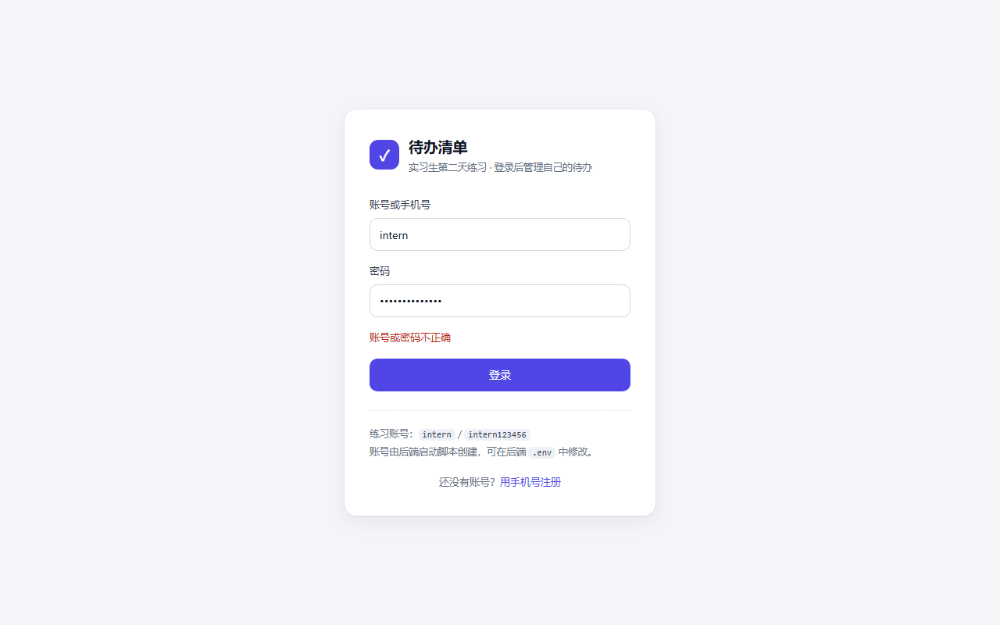
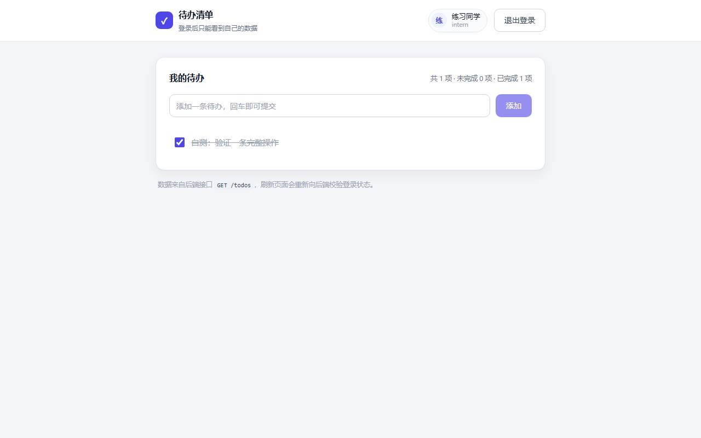
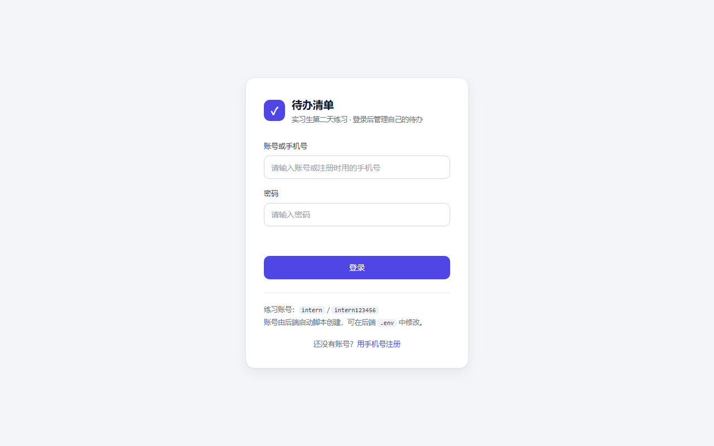
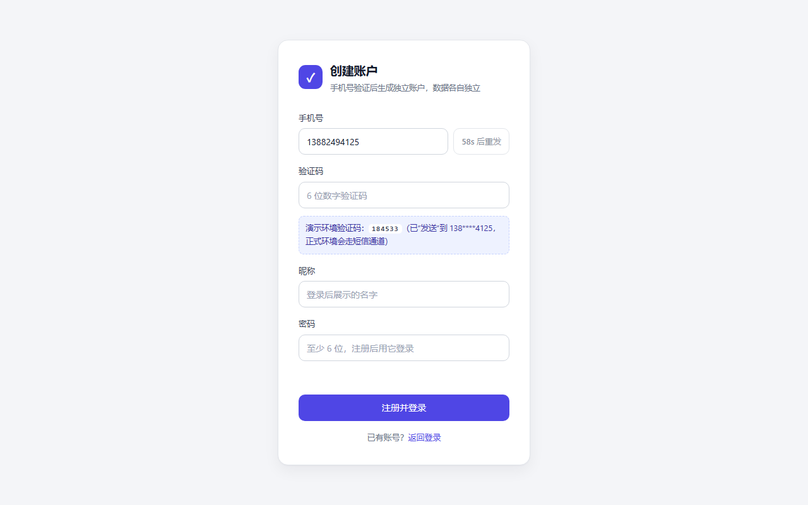
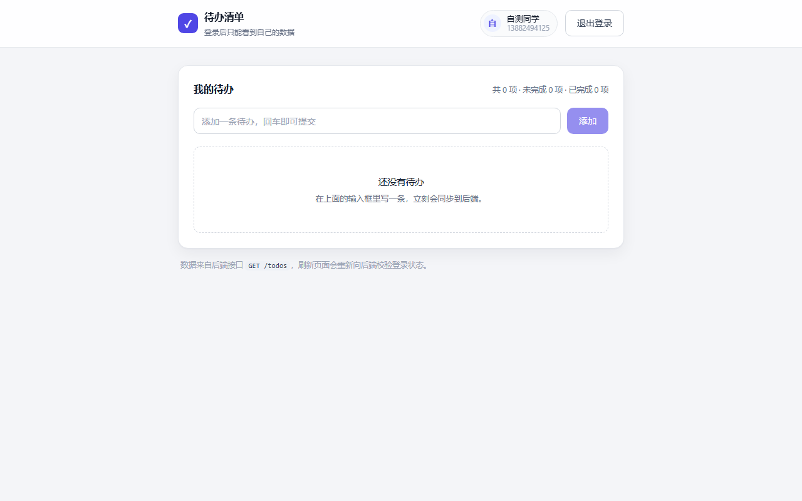
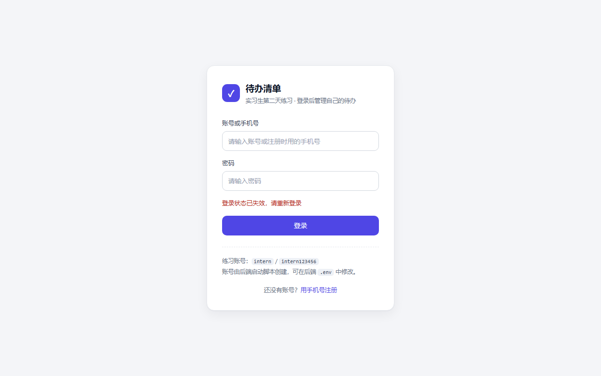
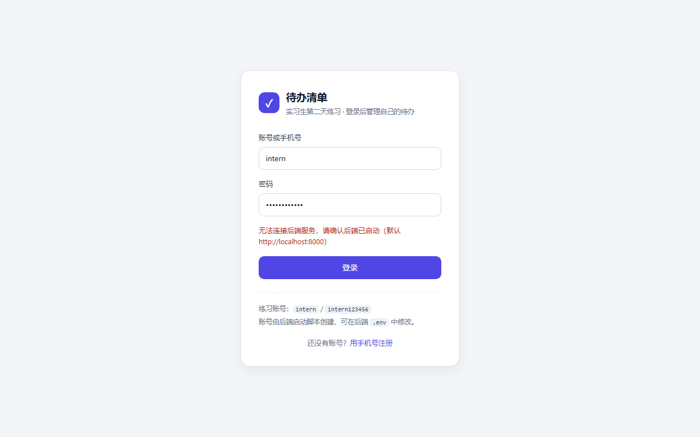

# 自测报告

> 对应《实习生第二天任务说明》第六节「自测清单」。
> 本报告同时存放在**前端仓库**与**后端仓库**的 `docs/` 目录下，内容一致；截图位于 `docs/screenshots/selftest/`。
> 测试日期：2026-10-27　测试人：田干（givenkills）

---

## 一、测试环境

| 项目 | 值 |
| --- | --- |
| 操作系统 | Windows 11 |
| Docker / Compose | 29.9.2 / Compose v5.6.1（Docker Desktop） |
| 前端运行时 | Node.js 22.22.2、pnpm 9.15.9（容器内 Node 22-alpine） |
| 后端运行时 | Python 3.13.14（本机）、3.12-slim（容器）、uv 0.13.6 |
| 浏览器 | Chrome 无头模式，视口 1280×800 |
| 后端分支 / 提交 | `feat/login-and-todo` / `fcbf5dc` |
| 前端分支 / 提交 | `feat/login-and-todo` / `435e815` |
| 前端地址 | <http://localhost:5173> |
| 后端地址 / 文档 | <http://localhost:8000> / <http://localhost:8000/docs> |
| 练习账号 | `intern` / `intern123456`（由后端启动脚本创建，虚构数据） |

> 提交号指**本报告提交之前**被测试的代码版本，报告本身是随后单独的一次文档提交。

---

## 二、测试结论

| 范围 | 项数 | 通过 | 失败 |
| --- | --- | --- | --- |
| 任务自测清单（第六节 12 项） | 12 | 12 | 0 |
| 补充检查（注册、隔离、安全、边界） | 8 | 8 | 0 |
| 自动化测试（pytest） | 33 | 33 | 0 |

**结论：12 项自测清单全部通过，前后端可独立启动并联调，多账户数据互相隔离，交付物可在另一个目录克隆复现。本轮未发现新的阻塞性问题。**

---

## 三、自测清单逐项结果

| # | 检查项 | 操作步骤 | 预期结果 | 实际结果 | 结论 |
| --- | --- | --- | --- | --- | --- |
| 1 | 容器启动 | 分别在两个仓库根目录执行 `docker compose up --build -d` | 前后端服务同时正常运行 | `docker compose ps`：后端 `Up (healthy)` 映射 `8000`，前端 `Up` 映射 `5173`；`/health` 返回 `200`，前端首页 `200` | 通过 |
| 2 | 正常登录 | 用 `intern / intern123456` 登录 | 进入功能页，显示后端返回的当前用户信息 | 跳转 `/todos`，右上角显示「练习同学 / intern」，数据来自 `GET /auth/me` | 通过 |
| 3 | 无效登录 | ① 空值提交 ② 错误密码 ③ 不存在的账号 | 登录失败或被校验拦截；错误账号与错误密码使用统一提示 | ① 前端拦截「请输入账号和密码」 ②③ 均返回「账号或密码不正确」，两次提示逐字相同 | 通过 |
| 4 | 页面保护 | 未登录时在地址栏直接输入 `/todos` | 返回登录页，不展示受保护内容 | `location.pathname` 变为 `/login`，页面为登录卡片，无任何待办内容 | 通过 |
| 5 | 接口保护 | ① 不带凭证 ② 伪造凭证 ③ 浏览器直接打开 `/todos` | 返回 `401`，无法绕过前端访问数据 | ① `GET /auth/me` → `401` ② `Bearer forged-token-value` → `401` ③ 页面显示 `{"detail":"未登录或缺少登录凭证"}` | 通过 |
| 6 | 刷新页面 | 登录后按 F5 刷新 | 行为与 README 一致；保留登录时必须重新向后端校验 | 刷新后仍在 `/todos`，AuthContext 重新调用 `GET /auth/me`，通过后才置为已登录 | 通过 |
| 7 | 凭证过期 | 临时把 `SESSION_TTL_MINUTES` 改为 `1`，登录后等待 70 秒再操作 | 后端返回 `401`，前端提示重新登录 | 过期后 `/auth/me` → `401`；点击新增 → 跳回 `/login`，提示「登录状态已失效，请重新登录」，本地令牌被清空 | 通过 |
| 8 | 退出登录 | 点击「退出登录」，再用退出前的凭证调用接口 | 返回登录页；旧凭证访问受保护接口返回 `401` | 回到 `/login`，`localStorage` 中令牌为 `null`；用旧令牌请求 `/todos` → `401` | 通过 |
| 9 | 自选功能 | 登录后新增一条待办，再勾选完成 | 后端处理数据，前端显示真实结果 | 列表 `0 → 1` 条，勾选后统计变为「共 1 项 · 未完成 0 项 · 已完成 1 项」，刷新后数据仍在 | 通过 |
| 10 | 网络异常 | 暂停后端容器后尝试登录，再恢复服务重试 | 显示可理解的失败提示，恢复后可以重新操作 | 提示「无法连接后端服务，请确认后端已启动（默认 http://localhost:8000）」，按钮从「登录中…」恢复；恢复后端后重新登录成功 | 通过 |
| 11 | 重启验证 | 两仓库分别 `docker compose down` 再 `up --build -d` | 能按 README 初始化或读取账号，数据与会话行为符合说明 | 服务重新启动；`intern` 的待办 1 条 → 1 条（SQLite 在命名卷）；账号可直接登录，会话表同样保留 | 通过 |
| 12 | 交付复现 | 在 `C:\Users\asus\WorkBuddy\repro-check` 克隆两仓库 → `git switch feat/login-and-todo` → `cp .env.example .env` → `docker compose up --build -d` | 可复现初始化、启动、登录和自选功能，不依赖原目录未提交的文件 | 全新数据卷自动初始化练习账号与 3 条示例待办；登录 `200`、新增 `201`、无令牌访问 `401`；前端页面正常 | 通过 |

### 关于第 12 项的说明

- 两个仓库的 `main` 分支只包含基础骨架（初始说明与工程配置），**业务代码在 `feat/login-and-todo` 分支上**，评审时按 PR 分支查看或 `git switch` 过去即可。
- 本机复现时给 Compose 指定了临时项目名（`-p repro-backend` / `-p repro-frontend`），目的是让数据卷是全新的，等价于「换一台机器」。README 中的默认命令在干净机器上效果相同。
- 复现完成后已 `docker compose -p ... down -v` 并删除临时目录，原服务恢复运行。

---

## 四、补充检查

| 检查项 | 操作 | 预期结果 | 实际结果 | 结论 |
| --- | --- | --- | --- | --- |
| 手机号注册 | 注册页填虚构手机号 → 获取验证码 → 提交 | 验证码正确时建号并自动登录 | 进入 `/todos`，顶部显示新昵称，列表为空 | 通过 |
| 验证码校验 | 提交错误验证码 / 重复手机号 | 分别给出错误提示 | 「验证码不正确，还可尝试 4 次」；重复手机号返回「该手机号已注册，请直接登录」 | 通过 |
| 多账户隔离 | 新账户与 `intern` 交替登录，对比列表 | 各自只看到自己的待办 | 新账户 0 条、`intern` 为自己的数据，互不出现 | 通过 |
| 越权访问 | 用 A 的凭证改 / 删 B 的待办 id | 不可操作 | 均返回 `404`，B 的数据未改变 | 通过 |
| 参数校验 | 空标题、121 字标题、非法手机号 | 返回 `422` 并指明字段 | `422` + `{"detail":"请求参数校验失败","errors":[{"field":...}]}` | 通过 |
| CORS 预检 | `OPTIONS /todos` 带 `Origin: http://localhost:5173` | 放行该来源 | 返回 `access-control-allow-origin: http://localhost:5173` 与 `allow-credentials: true` | 通过 |
| 并发与注入 | 20 个并发新增；标题写入 `` | 不出现 500；脚本不执行 | 20 个请求全部 `201`；标题以纯文本渲染，`window.__xss` 未被赋值 | 通过 |
| 构建与依赖 | 两镜像按锁文件构建 | 构建成功 | 后端按 `uv.lock`、前端按 `pnpm-lock.yaml` 安装，构建通过 | 通过 |

---

## 五、命令与日志摘要

### 5.1 容器状态

```text
$ docker compose ps                                  # intern-day-2-backend
NAME                             IMAGE                        STATUS                    PORTS
intern-day-2-backend-backend-1   intern-day-2-backend:local   Up (healthy)              0.0.0.0:8000->8000/tcp

$ docker compose ps                                  # intern-day-2-frontend
NAME                               IMAGE                         STATUS   PORTS
intern-day-2-frontend-frontend-1   intern-day-2-frontend:local   Up       0.0.0.0:5173->5173/tcp
```

### 5.2 后端日志摘要

```text
INFO:     Application startup complete.
INFO:     Uvicorn running on http://0.0.0.0:8000 (Press CTRL+C to quit)
INFO:     172.19.0.1:43700 - "GET /health HTTP/1.1" 200 OK
INFO:     172.19.0.1:44338 - "POST /auth/login HTTP/1.1" 200 OK
INFO:     172.19.0.1:44338 - "GET /auth/me HTTP/1.1" 200 OK
INFO:     172.19.0.1:44338 - "GET /todos HTTP/1.1" 200 OK
```

### 5.3 前端日志摘要

```text
  VITE v7.3.7  ready in 213 ms
  ➜  Local:   http://localhost:5173/
  ➜  Network: http://172.18.0.2:5173/
```

### 5.4 静态检查与自动化测试

```text
$ uv run pytest          →  33 passed
$ uv run ruff check .    →  All checks passed!
$ pnpm typecheck         →  通过，无报错
$ pnpm build             →  ✓ built in 1.36s，产物 gzip 约 82 kB
$ docker compose config  →  两个仓库均校验通过
```

### 5.5 接口抽查

```text
$ curl -X POST /auth/login  {"username":"intern","password":"intern123456"}   → 200 + access_token
$ curl -X POST /auth/login  {"username":"intern","password":"wrong"}          → 401 账号或密码不正确
$ curl /todos                                                               → 401 未登录或缺少登录凭证
$ curl /todos -H "Authorization: Bearer forged-token-value"                  → 401 登录凭证无效或已退出
$ curl -X PATCH /todos/{别人的id} -H "Authorization: Bearer <A的令牌>"        → 404 待办不存在
```

---

## 六、截图证据

> 截图均为测试过程中实时截取，未做任何修图；页面中出现的账号、手机号、待办内容都是虚构数据。

### 图 1　登录页（含练习账号提示）


### 图 2　未登录访问功能页被重定向回登录页（对应第 4 项）

截图后立即读取 `location.pathname`，结果为 `/login`，页面无任何受保护内容。


### 图 3　错误密码提示（对应第 3 项）



### 图 4　不存在的账号使用同一句提示（对应第 3 项）

与图 3 对照可见，两次提示文字完全一致，不泄露账号是否存在。


### 图 5　正常登录后的功能页（对应第 2 项）


### 图 6　新增并勾选完成（对应第 9 项）

统计行由「未完成 1 项」变为「未完成 0 项 · 已完成 1 项」，数据来自后端接口。



### 图 7　刷新页面后仍保持登录（对应第 6 项）


### 图 8　退出登录后回到登录页（对应第 8 项）

截图时 `localStorage` 中的令牌已为 `null`。



### 图 9　浏览器直接访问受保护接口被拒绝（对应第 5 项）

返回体为 `{"detail":"未登录或缺少登录凭证"}`，HTTP 状态码 `401`。


### 图 10　注册页：验证码已发送（补充检查）

开发模式下验证码直接显示在页面上，按钮进入 60 秒倒计时。



### 图 11　新注册账户看到的是空列表（补充检查 · 数据隔离）



### 图 12　凭证被服务端吊销后再操作，被踢回登录页（对应第 7、8 项）


### 图 13　凭证真实过期后的提示（对应第 7 项）

把有效期改成 1 分钟后真实等待 70 秒，再次操作触发 `401`。



### 图 14　后端不可用时的提示（对应第 10 项）



### 图 15　服务恢复后重新登录成功（对应第 10 项）


---

## 七、已知问题与限制

| 项目 | 说明 |
| --- | --- |
| 短信通道 | **是模拟实现**，验证码只写入后端日志并在开发模式下回传前端，未接入真实短信服务；上线需实现 `SmsSender` 并关闭 `SMS_DEBUG_RETURN_CODE` |
| 令牌存储 | 前端放在 `localStorage`，存在 XSS 面；生产应改为 HttpOnly Cookie + CSRF 防护 |
| 登录限流 | 验证码有次数与频次限制，密码登录暂未做失败次数限制与账号锁定 |
| 数据存储 | SQLite 单文件，未做并发写优化，不适合多实例部署 |
| 找回密码 / 换绑手机号 / 注销账户 | 未实现 |
| 待办能力 | 不支持修改标题、筛选与排序；删除无二次确认 |
| 已修复的历史问题 | 早期自测发现「同一瞬间连点两次添加/登录会重复提交」，已用 `useRef` 同步闸门修复（前端提交 `f5be1ed`），本轮回归通过 |

---

## 八、复现步骤（给评审者）

```bash
# 1. 克隆两个仓库（业务代码在功能分支上，main 只有基础骨架）
git clone https://github.com/givenkills/intern-day-2-backend.git
git clone https://github.com/givenkills/intern-day-2-frontend.git
cd intern-day-2-backend   && git switch feat/login-and-todo
cd ../intern-day-2-frontend && git switch feat/login-and-todo

# 2. 启动后端（另开终端）
cd ../intern-day-2-backend
cp .env.example .env          # 可选，默认值即可运行
docker compose up --build -d
curl http://localhost:8000/health

# 3. 启动前端
cd ../intern-day-2-frontend
cp .env.example .env
docker compose up --build -d

# 4. 浏览器打开 http://localhost:5173，用 intern / intern123456 登录
#    或点「用手机号注册」自行注册一个新账户
```

停止服务：在两个目录分别执行 `docker compose down`；如需清空练习数据，加 `-v`。
